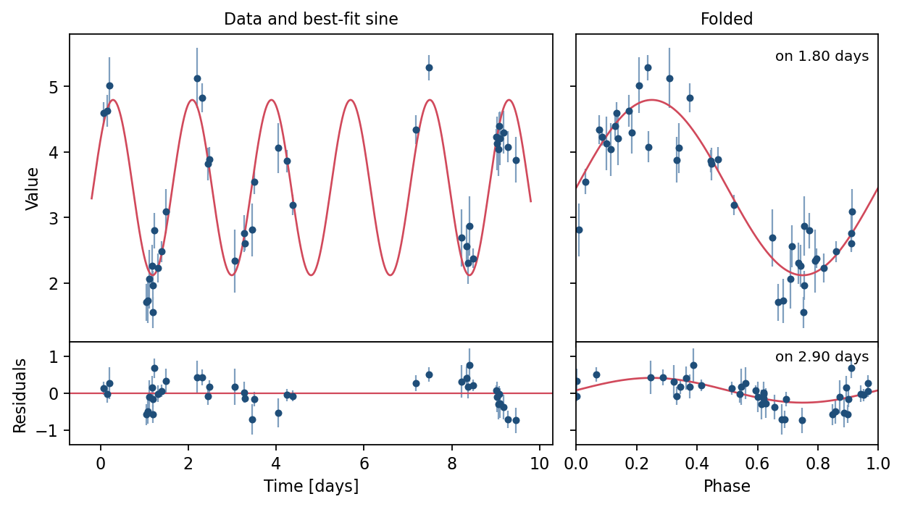
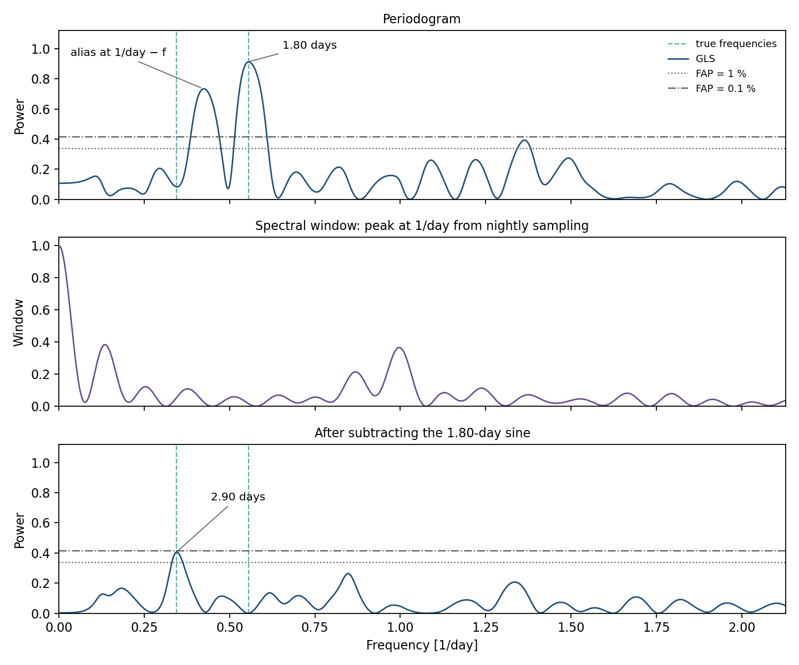

# periodogram

Period search in unevenly sampled data, optionally with individual
uncertainties.

## Overview

**Input:** times `t`, values `y`, and optionally their uncertainties
`err`, as `List<double>`. Instead of time, `t` can be any other
coordinate, such as position or wavelength; its unit determines the unit
of periods and frequencies.

**Methods:**

- **Generalized Lomb-Scargle periodogram** (`gls()`): fits a sine plus
  offset at each frequency, weighted by the uncertainties, as described by
  Zechmeister & Kürster (2009) and earlier by Ferraz-Mello (1981).
- **Classical Lomb-Scargle periodogram** (`lombScargle()`): the special
  case without uncertainties and with the mean subtracted beforehand.

**Output:**

- **Periodogram:** the power as a function of frequency.
- **False-alarm probability** of peaks, and power levels for given
  probabilities.
- **Best-fit sine** at the highest peak or any other frequency, with
  approximate errors.
- **Spectral window**, to recognize aliases caused by the sampling.

Unlike the FFT, none of this requires evenly spaced data.

## Usage example

Forty simulated measurements, taken in 8 nights within 10 days, with
individual uncertainties between 0.1 and 0.5. The signal consists of two
sines with periods of 1.8 and 2.9 days and amplitudes of 1.3 and 0.5:

```dart
import 'dart:math';

import 'package:periodogram/periodogram.dart';

void main() {
  // Simulated data: times in days, values, and their uncertainties
  final rnd = Random(15);
  const nights = [0, 1, 2, 3, 4, 7, 8, 9];
  final t = [
    for (int i = 0; i < 40; i++)
      nights[rnd.nextInt(nights.length)] + 0.5 * rnd.nextDouble()
  ]..sort();
  final err = [for (final _ in t) 0.1 + 0.4 * rnd.nextDouble()];
  double gauss() =>
      sqrt(-2 * log(1 - rnd.nextDouble())) * cos(2 * pi * rnd.nextDouble());
  final y = [
    for (int i = 0; i < t.length; i++)
      3.5 +
          1.3 * sin(2 * pi * t[i] / 1.8 + 0.75) +
          0.5 * sin(2 * pi * t[i] / 2.9 + 3.1) +
          err[i] * gauss()
  ];

  // Generalized Lomb-Scargle periodogram
  final p = gls(t, y, err: err);
  print(p.best.period); // about 1.80 days: the highest peak
  print(p.bestFap); // about 6e-19: false-alarm probability of the peak
  print(p.powerLevel(0.01)); // about 0.34: power at a FAP of 1 %

  // Classical Lomb-Scargle without the uncertainties: same period,
  // less significant
  print(lombScargle(t, y).bestFap); // about 4e-16

  // Subtract the best-fit sine and search again
  final model = p.best.evaluate(t);
  final residuals = [for (int i = 0; i < t.length; i++) y[i] - model[i]];
  final p2 = gls(t, residuals, err: err);
  print(p2.best.period); // about 2.93 days
  print(p2.bestFap); // about 1.5e-3
}
```

\
*Data with the best-fit 1.8-day sine and the residuals (left); the data
folded on 1.80 days and the residuals folded on 2.90 days, the period
found after subtracting the first sine (right).*

\
*Periodogram with false-alarm levels (top), spectral window (middle), and
periodogram after subtracting the best-fit sine (bottom).*

The periodogram (top) peaks at the 1.8-day period; dashed lines mark the
true frequencies. The second highest peak is an alias: the measurements
fall only into the night half of each day, which gives the spectral window
(middle) a peak at 1/day. A signal at f then has aliases at 1/day ± f; the
one at 1/day − f is the second highest peak. The weaker 2.9-day signal
does not stand out at first, but after subtracting the best-fit sine, it
becomes the highest peak, with a false-alarm probability of about 0.15 %
(bottom).

`p.frequencies` and `p.power` hold the periodogram itself. The figures
were made with a finer grid (`oversampling: 30`); the complete example is
in
[example/periodogram_example.dart](https://github.com/sczesla/periodogram/blob/main/example/periodogram_example.dart).

## Details

- **Input:** times `t`, values `y`, and optionally uncertainties `err`,
  as lists of the same length with at least 4 points. All values must be
  finite and the errors positive; the times must not all be equal, nor
  the values. Otherwise, an `ArgumentError` is thrown.
- **Model:** at each frequency f, the sine
  `a cos(2πft) + b sin(2πft) + c` is fitted by weighted least squares
  (weights `1/err²`); the combination of sine and cosine is equivalent to
  a (co)sine with a phase. With `fitMean: false`, the weighted mean is
  subtracted beforehand and `c` is not fitted. `lombScargle(t, y)` is
  this case without errors, i.e. the same as `gls(t, y, fitMean: false)`.
- **Power:** loosely, the fraction of the variance explained by the sine.
  More precisely, in the default normalization of Zechmeister & Kürster
  (2009), the relative reduction of χ² by the sine, between 0 and 1.
  `p.normalized(...)` converts it into the normalizations of Horne &
  Baliunas, Cumming et al., χ², weighted rms, ln L, and Δln L.
- **Frequency grid:** frequencies are in units of 1/(unit of `t`). By
  default, the grid is evenly spaced with step `1/(T · oversampling)`
  (time span `T`, `oversampling` 10), from one step up to the average
  Nyquist frequency `N/(2T)`, where `N` is the number of data points. Set `fMin`, `fMax`, `nyquistFactor`, or pass
  `frequencies` explicitly.
- **False-alarm probability:** `p.fap(power)` is the probability that pure
  Gaussian noise produces a peak at least this high somewhere in the
  searched band; `p.bestFap` is this probability for the highest peak.
  This analytic estimate uses an ad hoc number of independent frequencies
  (`p.independentFrequencies`) and assumes correct errors; numerical
  estimates can, e.g., be obtained by bootstrapping (not included).
  Conversely, `p.powerLevel(fap)` gives the power that corresponds to a
  given false-alarm probability.
- **Best-fit sine:** `p.best` (highest peak) or `p.sineFitAt(index)` give
  frequency, period, amplitude, phase, a time of zero phase `t0`, offset,
  and approximate errors; `evaluate(t)` computes the curve.
- **Spectral window:** `spectralWindow(t, frequencies, err: err)`, with
  `err` optional, computes
  `W(f) = |Σ wᵢ exp(2πi f tᵢ)|²` (Deeming 1975), the power spectrum of
  data that are 1 at every time, without subtracting the mean. The
  weights `wᵢ` are equal, or proportional to `1/errᵢ²` if `err` is given,
  and add up to 1, so that `W(0) = 1`. A peak of `W` at `f_w`, e.g. at
  1/day for nightly measurements, produces aliases at `f ± f_w` of every
  signal at `f`.
- **Performance:** the computation takes O(N × number of frequencies)
  time. In Flutter apps, run large computations in a background isolate,
  e.g. `Isolate.run(() => gls(t, y))`.

## References

- VanderPlas, J. T. 2018, ApJS, 236, 16: Understanding the Lomb-Scargle
  periodogram. A general introduction, including the spectral window,
  aliasing, and false-alarm probabilities
  ([arXiv:1703.09824](https://arxiv.org/abs/1703.09824)).
- Ferraz-Mello, S. 1981, AJ, 86, 619: Estimation of periods from unequally
  spaced observations.
- Zechmeister, M., & Kürster, M. 2009, A&A, 496, 577: The generalised
  Lomb-Scargle periodogram.
- Lomb, N. R. 1976, Ap&SS, 39, 447; Scargle, J. D. 1982, ApJ, 263, 835.
- Deeming, T. J. 1975, Ap&SS, 36, 137: Fourier analysis with unequally
  spaced data.
- Reference implementations in Python and other languages:
  [mzechmeister/GLS](https://github.com/mzechmeister/GLS) and
  [PyAstronomy](https://github.com/sczesla/PyAstronomy).
